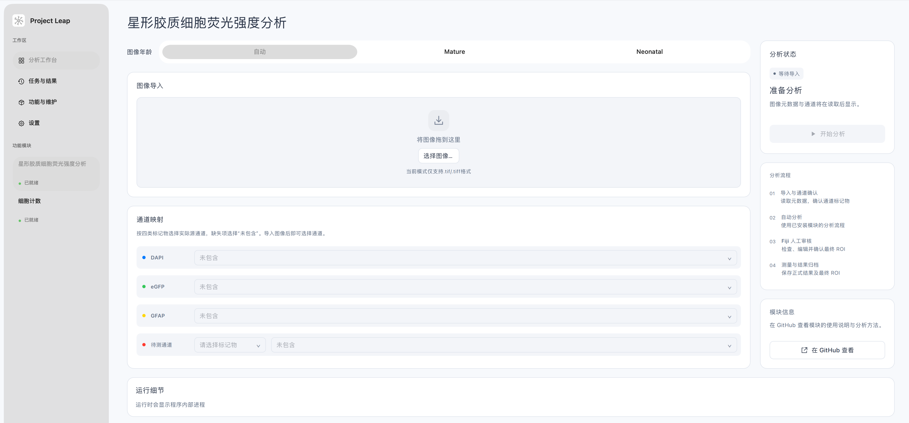

# Project Leap

[English](README.md) · [项目网站](https://dingchengwang.github.io/Project-Leap/zh/)

Project Leap 是面向 Mac 的模块化星形胶质细胞图像分析平台，用于多通道免疫组化（IHC）荧光图像。软件结合先进的开源模型与原创设计，在复杂背景中勾画精细的感兴趣区域（ROI）。这套独特的细胞框选机制为模块化设计提供了基础，开发者可据此扩展更多分析功能。

目前的两个模块分别用于星形胶质细胞荧光强度测量和三维图像堆栈中的细胞定位计数。荧光模块整合定制的 Fiji（ImageJ）流程，支持自动或半自动测量。所有科学计算均在本机完成。

## 安装与开始使用

[下载 Project Leap Mac 版](https://github.com/DingchengWang/Project-Leap/releases/download/v1.0.0/Project-Leap-1.0.0-macOS-arm64.dmg)。软件需要 **Apple Silicon Mac 和 macOS 27 或更新版本**。将 DMG 中的 **Project Leap.app** 复制到“应用程序”，再到软件的**功能与维护**中安装所需模块；程序会一并下载依赖组件。

[使用指南](docs/user-guide.zh.md)说明首次启动、模块安装、历史分析管理和设置。当前版本与[旧版独立脚本包](https://dingchengwang.github.io/Project-Leap/zh/downloads/#legacy)统一列在[下载页面](https://dingchengwang.github.io/Project-Leap/zh/downloads/)，主程序的版本变化见 [GitHub Releases](https://github.com/DingchengWang/Project-Leap/releases)。

## 选择分析模块

| 模块 | 输入与结果 | 文档 |
|---|---|---|
| 星形胶质细胞荧光强度分析 | 需要 DAPI、eGFP 和／或 GFAP，以及 KCNN1、KCNN2、KCNN3、KCNJ10 中的一个目标通道。在选定 Z 区间的二维最大强度投影上，分别测量完整细胞、胞体和突起区域的原始目标通道强度，包含背景信号。支持在 Fiji 中审核 ROI，导出测量表、叠加图和 ROI 文件。GFAP-only 分析仅适用于成熟样本。 | [使用指南](https://github.com/DingchengWang/Project-Leap-2D-Integrated-IHC-fluorescence-analysis/blob/main/docs/guide.zh.md) · [源码](https://github.com/DingchengWang/Project-Leap-2D-Integrated-IHC-fluorescence-analysis) |
| 细胞计数 | 需要 DAPI 和另一个由用户指定的辅助通道。结合不同 Z 层定位细胞，区分在二维视图中重叠的细胞。支持人工审核与编辑，将确认的 Astrocyte 计数导出为 CSV 表和编号叠加图，并保留可编辑会话。 | [使用指南](https://github.com/DingchengWang/Project-Leap-Cell-Counting/blob/main/docs/guide.zh.md) · [源码](https://github.com/DingchengWang/Project-Leap-Cell-Counting) |

软件将任务记录和结果与源 TIFF 图像分开保存。重新分析或再次查看原始 Z 层时仍需源图像，请予以保留。

<!-- leap-media:start readme-workspace -->
<figure class="media-figure">

<figcaption>分析工作台显示图像导入区，左侧列出可用模块。</figcaption>
</figure>
<!-- leap-media:end readme-workspace -->

## 源码与开发

本仓库保存桌面主程序、共享平台代码、构建工具和网站，两个分析引擎分别保存在上表链接的模块仓库中。开发者可按[构建说明](tools/build/README.md)准备依赖和打包；主程序与引擎之间的请求和结果格式见[接口与数据约定](docs/implementation/CONTRACT.md)。

## 作者与许可

开发者为 **Dingcheng Wang**，**俄亥俄州立大学**神经科学本科生。[关于 Project Leap](docs/about.zh.md)说明研究归属、AI 辅助开发，以及分析中使用的上游方法。

Project Leap 原创代码采用 [Apache License 2.0](LICENSE)。第三方软件与模型保留各自的许可证和声明，见 [THIRD_PARTY_NOTICES.md](THIRD_PARTY_NOTICES.md)。
