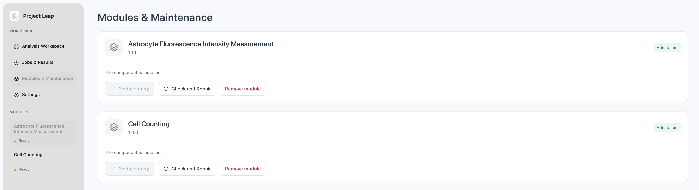
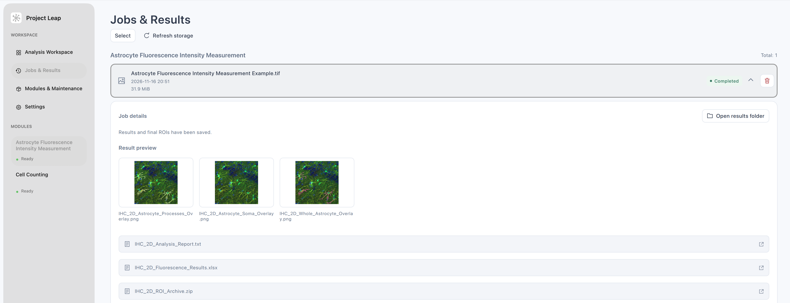
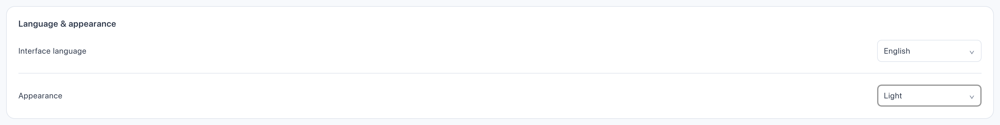

# User guide

[中文](user-guide.zh.md) · [Project home](../README.md) · [About](about.en.md)

**Current release: Project Leap v1.0.0.** After installing the main application, choose the analysis modules you need, then follow their guides to prepare images, run analyses, and review results. This guide covers installation, management of saved analyses, and application settings.

## 1. Install the main application

An **Apple Silicon Mac running macOS 27 or later** is required. You need an internet connection to download the main application, install modules, and obtain updates.

1. Open the [project website](https://dingchengwang.github.io/Project-Leap/en/) or [GitHub Releases](https://github.com/DingchengWang/Project-Leap/releases).
2. Download [Project-Leap-1.0.0-macOS-arm64.dmg](https://github.com/DingchengWang/Project-Leap/releases/download/v1.0.0/Project-Leap-1.0.0-macOS-arm64.dmg).
3. Open the DMG and drag **Project Leap.app** into the **Applications** folder.
4. Open Project Leap from Applications. You can eject the DMG once copying is complete.

The public DMG contains the main application. Analysis modules and their dependencies are installed through Project Leap.

### If macOS blocks the first launch

macOS may report that the developer cannot be verified or that Apple cannot check the application for malicious software.

If you downloaded the application from the project release page and choose to open it:

1. Try opening **Project Leap.app** once, then dismiss the alert.
2. Go to **System Settings → Privacy & Security** and scroll down to the message about the blocked application.
3. Click **Open Anyway**, then confirm **Open** in the next alert. Complete authentication if macOS requests it.

macOS saves the exception for that application. These steps follow [Apple’s official instructions for unnotarized applications](https://support.apple.com/en-us/102445). If an alert says the application will damage your computer or is damaged, investigate that issue separately. If an organization-managed Mac does not allow exceptions, contact its administrator.

## 2. Install analysis modules

1. Select **Modules & Maintenance** in the sidebar.
2. Find the module you need and click **Install analysis module**.
3. Keep the application open and wait for downloading, verification, and installation to finish.
4. The module is ready to use when its status shows **Installed** and its installation button reads **Module ready**.

You can install either module or both. Project Leap also installs the required dependencies. The fluorescence module uses Fiji to review regions of interest.

The application pauses installation and repair while an analysis or review process is using the components. Finish those operations before performing module maintenance.

<!-- leap-media:start guide-modules -->
<figure class="media-figure">

<figcaption>Both analysis modules are installed.</figcaption>
</figure>
<!-- leap-media:end guide-modules -->

## 3. Choose a module and start an analysis

Select an installed module in the sidebar to open its **Analysis Workspace**. Follow the corresponding guide to select images, assign channels, run the analysis, review the results, and save:

| Module | Purpose | Guide |
| --- | --- | --- |
| **Astrocyte Fluorescence Intensity Measurement** | Measure fluorescence intensity within astrocyte regions of interest and review those regions in Fiji. | [Fluorescence module user guide](https://github.com/DingchengWang/Project-Leap-2D-Integrated-IHC-fluorescence-analysis/blob/main/docs/guide.en.md) |
| **Cell Counting** | Review candidate cells identified from DAPI and the support channel, edit the count, and save the confirmed results. | [Cell Counting user guide](https://github.com/DingchengWang/Project-Leap-Cell-Counting/blob/main/docs/guide.en.md) |

During analysis, **Run details** shows progress and messages. You can switch to other pages or modules while it runs, then start another analysis once the current one finishes.

After completing manual review, save the results using the module’s controls. Cell Counting saves edits as a draft so you can continue reviewing later. The application saves confirmed results only after you click **Confirm & save Astrocyte count**. Any edits made after confirmation remain in the draft; confirm again to save them as a new result version.

## 4. View and manage saved analyses

Open **Jobs & Results**. Jobs are grouped by module. Click a record to expand **Job details** and view its status, result previews, and output files.

- Click a preview or filename to open the corresponding file. For a completed job, **Open results folder** opens its output directory.
- Expand **Run details** to view saved records of the software, inputs, parameters, review, and time taken. The available details depend on what was recorded for that job.
- For counting jobs, use **Reopen count** to edit a saved count, or **Continue count review** to resume an existing review session. See the counting module guide for how to save changes.
- Click **Refresh storage** to update the estimated disk space each analysis uses within application storage.

To delete a single analysis, click the trash button on its row. To delete several analyses, click **Select**, select the records, and click **Delete selected**. Check the scope before confirming: this permanently deletes the selected analyses’ data saved within the application. Original images and files exported outside the application data folder are retained. Selecting **Don’t ask again for one month** suppresses deletion confirmations; the application resumes asking after one calendar month.

Original images are required to rerun an analysis or view the original Z planes, so keep these files. If a counting session reports that its source image has moved, use the relocation control within that session. The application checks whether the image at the new path matches the job.

<!-- leap-media:start guide-jobs -->
<figure class="media-figure">

<figcaption>The expanded fluorescence job shows overlay previews, exported files, and a button to open the results folder.</figcaption>
</figure>
<!-- leap-media:end guide-jobs -->

## 5. Adjust settings

### Language and appearance

Go to **Settings → Language & appearance**. You can choose **English** or **中文** for the interface language, and **System**, **Light**, or **Dark** for the appearance. Fiji and pages opened in a browser use their own appearance settings.

<!-- leap-media:start guide-appearance -->
<figure class="media-figure">

<figcaption>Choose the interface language and Light appearance in Settings.</figcaption>
</figure>
<!-- leap-media:end guide-appearance -->

### Storage and migration

**Settings → Storage & data** shows the current application data folder. Click **Open application data** to open it in Finder. This folder contains installed components, job records, review data, and saved results.

To move the data, finish any active work, click **Change storage folder**, and select a **new, empty folder**. Wait for the application to migrate and verify the data and finish restarting. Use this control to change where managed data is stored; moving the folder directly in Finder leaves the application pointing to the old path.

Original input images remain in their original locations. Migrating application data does not move those images or externally exported files. If the application reports that its configured data folder is missing, reconnect the corresponding drive or restore the folder before reopening the application.

### Clear caches

In **Storage & data**, click **Clear cache** and confirm to remove interface caches that can be regenerated and temporary files that are no longer in use. Original images, analysis results, and review data are retained. To remove an analysis and its saved data, use job deletion.

### Update the application

Go to **Settings → Software updates → Check for Updates** to check the main application and installed modules together. Follow the update prompts. Components are activated only after downloading and verification, and an update to the main application restarts it. If an update requires components that are still in use, it waits for the relevant work to finish.

### Check and repair a module

In **Modules & Maintenance**, click **Check and Repair** for an installed module. The application checks the component contents and repairs missing or damaged components using the same version that is currently installed. If full verification passes, it reports that no repair is needed. Use **Check for Updates** to upgrade to an available newer version.

### Remove modules or uninstall the application

**Remove module** in **Modules & Maintenance** removes the module’s runtime components while retaining its job history and results. Shared components still used by other installed modules are retained. If no module needs a shared model or Fiji, the application may ask whether to remove them as well.

**Settings → Uninstall application** offers two options. One retains jobs, final regions of interest, finalized results, and necessary recovery data. The other also permanently deletes the application data folder. Neither option affects original inputs outside that folder. Choose the uninstall option according to the data you need to retain.

## 6. Handle interrupted operations

| What happens | Next step |
| --- | --- |
| Module download or installation fails | Read the message in **Modules & Maintenance**. Restore the network connection if needed, then retry. If an installed module shows **Repair needed**, click **Check and Repair**. |
| Component verification fails | Retry through the application. If it fails again, report the full message and module version through [GitHub Issues](https://github.com/DingchengWang/Project-Leap/issues). |
| A maintenance button is unavailable | Finish the analysis, review, or update currently using the components, then retry. |
| An analysis fails or is interrupted | In **Jobs & Results**, check the job’s message and **Run details**, then follow the module guide for the affected step. Repair the module when the message explicitly identifies a component problem. |
| A result preview does not load | Click the preview to open the original output file, or use **Open results folder**. |
| A source image or application data folder cannot be found | Restore the original location or reconnect the drive. If a counting source image has moved, use the relocation control within its session. |

When reporting a problem, include the Project Leap version, module version, macOS version, the operation that failed, and the full message. Attach images only if you are authorized to share the image data.
